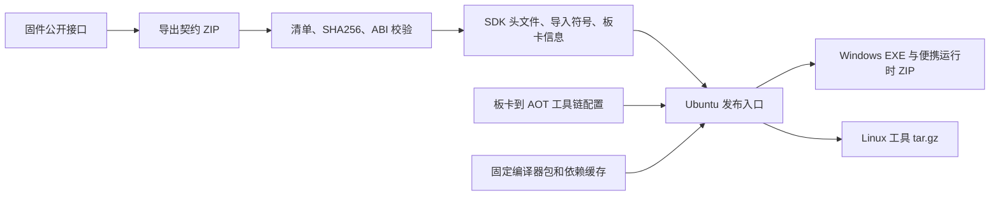

# SDK 发布：Ubuntu 一次打包 Windows 和 Linux

推荐从一个 Ubuntu x86_64 工作区发布两个主机包。Windows 保留 `aster.exe`、`aster-toolchain.exe`、`aster-device.exe`，使用便携目录 ZIP；Linux 使用目录 tar.gz。Windows 不需要安装 Python 或 WSL；Linux 需要与打包环境相同的 Python 小版本，当前发布流程为 Python 3.12，依赖已随包提供。当前验证环境为 Ubuntu 22.04 / glibc 2.35、Windows x64，CI 使用 Ubuntu 24.04。

## 接口与编译器分开更新



固件仓库负责导出 `contract/lock.json`、`contract/api.json`、`include/aster/` 和 `targets/`。SDK 导入这些公开文件，不读取固件内部源码。添加接口后，新的公开声明、导入符号、ABI 与能力信息随契约进入 SDK。工具从这些数据读取规则，普通接口增加无需重编 Windows EXE 启动器以外的原生编译器。

发布包中的模板 ABI 自动跟随契约，并生成 `docs/api-index.md`。函数的用途、单位、生命周期和示例仍需在固件公开头文件或手册中维护；只有符号和签名不能推导这些语义。新的通信协议、打包格式或特殊功能逻辑仍需要修改对应工具代码。

`toolchains/catalog.json` 独立定义“开发板 → CPU/AOT 后端 → 编译器配置 → 主机二进制及校验值”。**主机架构决定编译器在哪里执行，板卡架构决定编译器输出什么 AOT。** 当前登记并验证的是 `lckfb-s3` / Xtensa / AOT 格式 6，包里携带该板所需的工具链。

## 一次性准备

Ubuntu 安装 Python 3.12、venv 和 `gcc-mingw-w64-x86-64`，然后创建发布环境：

```bash
python3.12 -m venv .venv-linux
.venv-linux/bin/python -m pip install -r requirements.txt
```

仓库提供 Linux 编译器。Windows 编译器作为固定依赖包复用，不能把 Linux 的 `wamrc` 当作 Windows 程序使用。已有 Windows 编译器缓存可在 Ubuntu 中导出一次：

```bash
.venv-linux/bin/python tools/toolchain_bundle.py \
  --board lckfb-s3 \
  --output dist/toolchains/windows-x64-esp32s3-wamr-2.4.3-v6.zip
```

该命令要求配置中的 Windows `wasi` 和 `wamrc` 文件已准备好。首次获得或重编这两个原生工具是工具链维护工作；后续 ABI 更新复用该 ZIP。把它存入团队制品库，并保存命令输出的 SHA256。新 Ubuntu 机器只需下载这个编译器包和 SDK，无需到 Windows 克隆 SDK 或重新打包。

## 日常发布命令

```bash
bash release.sh \
  --contract /path/to/aster-contract.zip \
  --board lckfb-s3 \
  --hosts linux-x64,windows-x64 \
  --windows-toolchain-bundle /path/to/windows-x64-esp32s3-wamr-2.4.3-v6.zip
```

SDK 内的契约已经更新时，省略 `--contract`。本机已有配置指定的 Windows 编译器缓存时，也可省略 `--windows-toolchain-bundle`。远程依赖使用 `--windows-toolchain-url URL --windows-toolchain-sha256 SHA256`。

首次联网获取官方 Windows 嵌入式 Python 和 Python wheels，之后通过 `build/portable-cache/` 复用已锁定并校验的文件。更新 Python 依赖版本时需同步更新脚本固定版本并清理对应的 wheel 缓存，以重新生成 `resolved.json`；每个发布包保留依赖清单与校验值。

输出在 `dist/portable/`，文件名包含 ABI、主机、板卡与构建指纹。包内包含 `release.json`、`toolchain-profile.json`、`dependencies.json` 和 `SHA256SUMS.txt`。三个 Windows EXE 必须随整个目录一起替换；统一入口会拒绝混用不同发布版本的工具。

Linux 包生成前会用包内工具创建独立项目，实际编译 WASM、板卡 AOT，并验证 APP 包及 AOT 格式。Windows 包可在 Windows 上运行同一验证：

```powershell
.\runtime\python.exe .\tools\verify_windows_release.py .
```

## Gitee 发布与下载

当前源码仓库为 `https://gitee.com/helloworldmyj/aster-sdk`。先提交并推送源码，再创建 `sdk-v*` 标签，在仓库的发行版页面使用该标签创建版本。把生成的 Windows ZIP、Linux tar.gz 和 SHA256 校验文件作为附件上传。固定 Windows 编译器 ZIP 也需要在发行版或制品库提供下载，以便新 Ubuntu 发布机器取得依赖；克隆 Git 仓库本身不会获得这个 ZIP。

应用开发者从发行版下载与电脑平台、开发板匹配的 SDK 成品，完整解压后运行 `aster install` 生成环境脚本。Windows 成品自带 Python；Linux 成品需要 Python 3.12。无需克隆 SDK 源码或自行编译工具链。接口更新后下载新 SDK、重新激活环境并重编应用，设备固件应与该 SDK 的板卡和 ABI 匹配。

## GitHub CI 与后续架构

`.github/workflows/portable-sdk.yml` 仅在 GitHub 执行，推送到 Gitee 不会触发。该流程在 Ubuntu 完成两个平台的打包。Windows runner 只下载成品、验证 EXE 和 AOT 构建，不克隆源码、不再打包。测试通过后，`sdk-v*` 标签才发布 GitHub Release；普通提交只生成可下载的 CI 制品。

使用 GitHub 自动发布时，先把固定 Windows 编译器 ZIP 上传到可访问的制品库，再配置仓库变量 `ASTER_WINDOWS_TOOLCHAIN_URL`、`ASTER_WINDOWS_TOOLCHAIN_SHA256`。旧 Windows 单文件打包流程保留为手动兼容入口。

添加 RISC-V 或其他开发板时：

1. 固件导出新板卡的契约，给出准确 CPU、AOT target、ABI、能力与协议。
2. 为该架构准备匹配固件运行时的 AOT 编译器，登记 Linux/Windows 主机二进制与 SHA256。两块板共用完全相同的后端和编译参数时可以复用 profile。
3. 在 `toolchains/catalog.json` 加板卡绑定。缺少主机工具链或架构不一致时发布直接报错。
4. 用该板执行独立 APP 构建、设备握手、安装和实机运行，再启用对应的 CI 发布矩阵；需要不同烧录协议时扩展设备工具。

仅添加接口通常更新契约并重新封装；只有 CPU 后端、AOT 格式、运行时兼容性或编译选项改变时才重建对应工具链。当前流程只支持 x86_64 主机，其他主机架构需要增加对应运行时与原生工具配置。

## 共享串口 SDK 更新（2026-10-05）

新版固件在 shell 串口同时提供日志、命令与 ASTERFS 3 文件传输。部署握手包含 `serial=shared` 时，SDK 自动使用同一连接上传、安装、运行；LCKFB 如 `aster run --port /dev/ttyUSB0`，Windows 如 `aster run --port COM24`。旧固件继续支持显式双串口参数。独立监视器在传输、shell 或截图前关闭，完成后再打开同一端口。

此更新不改变公开 ABI 3.7.0、ASTP 包格式或 AOT 格式 6，已有 APP 不需要因此重编。此次发布仍使用已登记的 `lckfb-s3` 工具链配置。SDK 主机工具代码必须同步更新；便携包从新版脚本生成，不能只复制文档并沿用旧运行工具。

两种主机包现在完整携带 `docs/`、`.agents/skills/aster-app-development/`、`apps/` 示例、`assets/` 与 README，保留 Skill 到开发手册的相对链接。手册、Skill、示例与素材、README 和许可证均纳入构建指纹，包内 SHA256 清单也包含它们。发布时工具、手册和 Skill 随同一个 ZIP/tar.gz 交付，避免文档与工具混用。详细操作见 `docs/serial-console-transfer.md`。
