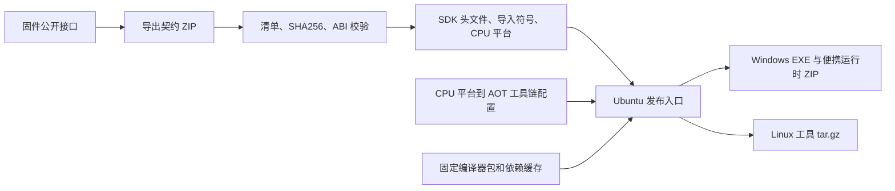

# SDK 发布：Ubuntu 一次打包 Windows 和 Linux

推荐从一个 Ubuntu x86_64 工作区发布两个主机包。Windows 保留 `aster.exe`、`aster-toolchain.exe`、`aster-device.exe`，使用便携目录 ZIP；Linux 使用目录 tar.gz。Windows 不需要安装 Python 或 WSL；Linux 需要与打包环境相同的 Python 小版本，当前发布流程为 Python 3.12，依赖已随包提供。当前验证环境为 Ubuntu 22.04 / glibc 2.35、Windows x64，CI 使用 Ubuntu 24.04。

## 接口与编译器分开更新



固件仓库负责导出 `contract/lock.json`、`contract/api.json`、`include/aster/` 和 `targets/`。SDK 导入这些公开文件，不读取固件内部源码。添加接口后，新的公开声明、导入符号、ABI 与能力信息随契约进入 SDK。工具从这些数据读取规则，普通接口增加无需重编 Windows EXE 启动器以外的原生编译器。

发布包中的模板 ABI 自动跟随契约，并生成 `docs/api-index.md`。函数的用途、单位、生命周期和示例仍需在固件公开头文件或手册中维护；只有符号和签名不能推导这些语义。新的通信协议、打包格式或特殊功能逻辑仍需要修改对应工具代码。

`toolchains/catalog.json` 定义“CPU 平台 → AOT 后端 → 编译器配置 → 主机二进制及校验值”。主机架构决定编译器在哪里执行，CPU 平台决定编译器输出什么 AOT。当前目标为 `xtensa`，使用 `esp32s3-wamr-2.4.3-v6` 配置；同一个 APP 包可部署到兼容的立创或微雪固件。每个主机平台只发布一个便携包，构建与部署使用 `--target xtensa`，设备通过 `--port` 指定。SDK 不选择开发板，也不构建固件。

包内可以携带多个 CPU 编译配置，但必须共用同一 wasi-sdk 版本，且一个 AOT 后端只能对应一个配置。多后端包把 `wamrc` 放在 `toolchain/backends/<backend>/`；单配置包保持 `toolchain/wamrc[.exe]` 布局。

## 一次性准备

Ubuntu 安装 Python 3.12、venv 和 `gcc-mingw-w64-x86-64`，然后创建发布环境：

```bash
python3.12 -m venv .venv-linux
.venv-linux/bin/python -m pip install -r requirements.txt
```

仓库提供 Linux 编译器。Windows 编译器作为固定依赖包复用，不能把 Linux 的 `wamrc` 当作 Windows 程序使用。已有 Windows 编译器缓存可在 Ubuntu 中导出一次：

```bash
.venv-linux/bin/python tools/toolchain_bundle.py \
  --target xtensa \
  --output dist/toolchains/windows-x64-esp32s3-wamr-2.4.3-v6.zip
```

该命令要求配置中的 Windows `wasi` 和 `wamrc` 文件已准备好。首次获得或重编这两个原生工具是工具链维护工作；后续 ABI 更新复用该 ZIP。把它存入团队制品库，并保存命令输出的 SHA256。新 Ubuntu 机器只需下载这个编译器包和 SDK，无需到 Windows 克隆 SDK 或重新打包。

## 日常发布命令

```bash
bash release.sh \
  --contract /path/to/aster-contract.zip \
  --hosts linux-x64,windows-x64 \
  --windows-toolchain-bundle /path/to/windows-x64-esp32s3-wamr-2.4.3-v6.zip
```

默认打包 `targets/` 下全部 CPU 平台；当前只有 `xtensa`。发布工具的兼容参数 `--boards xtensa` 表示平台子集，并不选择开发板。SDK 内的契约已经更新时，省略 `--contract`。导入固件契约时先验证源包清单和哈希，再把板卡描述转换为已登记编译器支持的 CPU 平台；不导入板卡屏幕尺寸、堆上限或传感器配置。本机已有配置指定的 Windows 编译器缓存时，也可省略 `--windows-toolchain-bundle`。远程依赖使用 `--windows-toolchain-url URL --windows-toolchain-sha256 SHA256`（固定编译器包只服务单配置；多后端包需要把每个配置的原生工具预先备好）。

首次联网获取官方 Windows 嵌入式 Python 和 Python wheels，之后通过 `build/portable-cache/` 复用已锁定并校验的文件。更新 Python 依赖版本时需同步更新脚本固定版本并清理对应的 wheel 缓存，以重新生成 `resolved.json`；每个发布包保留依赖清单与校验值。

输出在 `dist/portable/`，每个主机平台一个包，文件名包含 ABI、主机与构建指纹。包内包含 `release.json`（`boards` 兼容字段，内容为 CPU 平台名）、`toolchain-profile.json`（`profiles`：每个编译配置的后端、格式与 CPU 平台）、`dependencies.json` 和 `SHA256SUMS.txt`。三个 Windows EXE 必须随整个目录一起替换；统一入口会拒绝混用不同发布版本的工具。

Linux 包生成前会用包内工具为每个已登记 CPU 平台各建一个独立项目，实际编译 WASM 与对应后端的 AOT，并验证 APP 包及 AOT 格式。Windows 包可在 Windows 上运行同一验证（同样逐 CPU 平台循环）：

```powershell
.\runtime\python.exe .\tools\verify_windows_release.py .
```

## GitHub 发布与下载

当前源码仓库为 `https://github.com/hello-myj/aster-sdk`，Git 仅保留 GitHub 远程。先提交并推送源码，再创建 `sdk-v*` 标签，在仓库的发行版页面使用该标签创建版本。把生成的 Windows ZIP、Linux tar.gz 和 SHA256 校验文件作为附件上传。固定 Windows 编译器 ZIP 也需要在发行版或制品库提供下载，以便新 Ubuntu 发布机器取得依赖；克隆 Git 仓库本身不会获得这个 ZIP。

应用开发者从发行版下载与电脑平台匹配的 SDK 成品（每个主机平台一个包，内含已登记 CPU 平台），完整解压后运行 `aster install` 生成环境脚本。Windows 成品自带 Python；Linux 成品需要 Python 3.12。无需克隆 SDK 源码或自行编译工具链。接口更新后下载新 SDK、重新激活环境并重编应用，设备固件应与该 SDK 的 CPU 平台和 ABI 匹配。

## GitHub CI 与后续架构

`.github/workflows/portable-sdk.yml` 在 GitHub 执行。该流程在 Ubuntu 完成两个平台的打包。Windows runner 只下载成品、验证 EXE 和 AOT 构建，不克隆源码、不再打包。测试通过后，`sdk-v*` 标签才发布 GitHub Release；普通提交只生成可下载的 CI 制品。

使用 GitHub 自动发布时，先把固定 Windows 编译器 ZIP 上传到可访问的制品库，再配置仓库变量 `ASTER_WINDOWS_TOOLCHAIN_URL`、`ASTER_WINDOWS_TOOLCHAIN_SHA256`。旧 Windows 单文件打包流程保留为手动兼容入口。

添加新的 CPU 平台时：

1. 固件导出新板卡的契约，给出准确 CPU、AOT target、ABI、能力与协议。
2. 为该架构准备匹配固件运行时的 AOT 编译器，登记 Linux/Windows 主机二进制与 SHA256。与既有板卡共用完全相同的后端和编译参数时复用 profile，否则新增一个 profile；新 CPU 家族通常对应新后端，发布包会在 `toolchain/backends/<backend>/` 下与既有后端并列携带，`--target` 自动选择。
3. 在 `toolchains/catalog.json` 加 CPU 平台绑定。缺少主机工具链、架构不一致、同一后端挂两个 profile，或包内 wasi-sdk 版本不一致时，发布直接报错。
4. 用该 CPU 平台的设备执行独立 APP 构建、设备握手、安装和实机运行，再启用对应的 CI 发布矩阵；需要不同烧录协议时扩展设备工具。

仅添加接口通常更新契约并重新封装；只有 CPU 后端、AOT 格式、运行时兼容性或编译选项改变时才重建对应工具链。当前流程只支持 x86_64 主机，其他主机架构需要增加对应运行时与原生工具配置。

## 共享串口 SDK 更新（2026-10-05）

新版固件在 shell 串口同时提供日志、命令与 ASTERFS 3 文件传输。部署握手包含 `serial=shared` 时，SDK 自动使用同一连接上传、安装、运行；LCKFB 如 `aster run --port /dev/ttyUSB0`，Windows 如 `aster run --port COM24`。旧固件继续支持显式双串口参数。独立监视器在传输、shell 或截图前关闭，完成后再打开同一端口。

此更新不改变公开 ABI 3.7.0、ASTP 包格式或 AOT 格式 6，已有 APP 不需要因此重编。当前 SDK 使用 `xtensa` CPU 平台的工具链配置，兼容立创与微雪 ESP32-S3。SDK 主机工具代码必须同步更新；便携包从新版脚本生成，不能只复制文档并沿用旧运行工具。

两种主机包现在完整携带 `docs/`、`.agents/skills/aster-app-development/`、`apps/` 示例、`assets/` 与 README，保留 Skill 到开发手册的相对链接。手册、Skill、示例与素材、README 和许可证均纳入构建指纹，包内 SHA256 清单也包含它们。发布时工具、手册和 Skill 随同一个 ZIP/tar.gz 交付，避免文档与工具混用。详细操作见 `docs/serial-console-transfer.md`。

## 立创与微雪固件同步（2026-10-11）

当前固件支持立创 `lckfb-s3` 和微雪 `waveshare-35b`，由固件配置选择硬件；SDK 始终使用 CPU 目标 `xtensa`，换板只需指定对应串口。APP 用 `aster_display_get_info()` 获取实际尺寸，使用能力查询判断相机、IMU 等差异。

本次固件合并了光带动画与字形缓存优化、立创截屏修复、顶栏字号和点击区域调整。公开头文件、ABI 3.7.0、ASTP 和 AOT 格式 6 均未改变；SDK 不需要增加字体资源或升级 ABI，已有兼容 APP 包无需因此重编。桌面动态 APP 名称和简介来自安装包，使用通用 SD 字库；固定系统 UI 字体由固件维护。

SDK 文档、CI 和契约导入工具已统一为 CPU 平台目标。发布新版主机工具时应重新生成便携包，让工具、手册和配置保持一致；本次同步本身不创建发行版或重建原生编译器。

## 真实设备执行策略（2026-10-11）

Zephyr 设备固件只运行匹配 CPU 的 AOT，构建中关闭 WASM 解释器。安装拒绝没有 AOT 或 CPU 不匹配的包，加载错误直接报错并保留原 AOT 文件。模拟器/主机测试可以使用 WASM；`.ast` 仍可同时包含 WASM 和 AOT，公开 ABI 3.7.0 与包格式不变。旧的 WASM-only APP 需要使用 `aot = true` 或 `aster build --aot` 重建后安装，原来已经包含兼容 AOT 的包不需要为策略调整重编。

## 操作文档发布门禁

发布前执行 `python tools/check_docs.py`。便携打包入口也自动检查 README、开发手册、CLI 文档、Skill 和示例说明中的 CPU 目标参数、输出目录及当前 ABI 声明；过期板卡目标或 ABI 会阻止生成发布包。历史交接记录必须在首行标记 `<!-- aster-docs: historical -->`，下一行明确说明是历史记录并指向本发布指南。历史 ABI 变更说明不属于当前 ABI 声明。

固件仓库独立运行同名检查，对照其公开 ABI 头文件与 `hardware/` 清单检查架构文档及板级部署命令，契约导出前自动执行；SDK 发布不依赖固件源码路径。修改公开 ABI、CPU 目标或硬件清单时，两仓库均须更新相应操作文档并通过检查。

## 三仓库候选组合检查

正式候选在固件仓库执行 `python tools/release_check.py --sdk ../aster-sdk --sim ../aster-sim --require-clean --output build/release-check`，并等待三仓库集成及两块板完整构建通过。固定提交和工具链 profile 在固件 `contract/release-matrix.json`；报告和必需 APP 制品必须保留。详见 [固件发布验证](https://github.com/hello-myj/aster-firmware/blob/main/docs/release-validation.md)。此命令由固件工具提供，不是 SDK 的 APP CLI，也不会自动发布或刷机。

## SDK Release 作为统一成品入口

当前发布把 SDK、固定固件镜像、SD 字体资源和主机模拟器放入同一个完整 SDK 包。对应 tag、提交、ABI 与载荷哈希见 contract/release-family.json；用户仅下载该 SDK Release 的本机平台包即可。此前工具包只包含 SDK 的说明不代表完整开发套件交付范围。固件和模拟器仓库各保留源码 tag，SDK 打包只校验并加入已有成品，不编译固件。详细布局、使用步骤和维护流程见 [完整开发套件](development-kit.md)。

## 2026-10-15完整套件

本组SDK标签为sdk-v3.7.0-20261015.1，配套firmware-v0.1.0-20261015及sim-v0.2.0-20261015，精确提交和成品哈希由contract/release-family.json固定。保留ABI3.7.0和现有编译器profile，不重新下载Espressif驱动库。固件内核堆96 KiB、字体与launcher更新不新增APP网络导入。

发布前验证两个完整主机包中的SDK、模拟器与两板镜像；使用包内工具实际创建独立工程、编译WASM/Xtensa AOT、校验及模拟运行。新候选检查使用显式--matrix固定本次SDK提交，保留此前已发布矩阵；源码侧运行时兼容基线与SDK发布元数据提交可能不同，以本次干净集成报告和release-family为准。硬件状态区分LCKFB短时实机通过和微雪本轮未测，详细说明见development-kit.md。

本组修订标签为sdk-v3.7.0-20261015.1：修复干净发布环境中先查找本机Windows编译器、后读取固定编译器ZIP的顺序问题；现在先校验并加载所提供的编译器包，已有缓存不再掩盖该路径。增加无本机编译器及错误哈希拒绝回归。此前未带.1的预发布标签保留，不移动已公开标签；完整成品请使用.1修订。
